# Traveler Task DAG

| 항목 | 내용 |
|---|---|
| 생성 | 2026-10-11T20:18:46+09:00 — `python3 scripts/build_waves.py` |
| Task 수 | 61 |
| 의존 간선 수 | 177 |
| 순환 의존성 | 0 |
| 최장 의존 단계 | 9 |

## 1. Task 의존 관계

| Seq | Task | Category | 단계 | Wave | Depends On | 후행 Task |
|---:|---|---|---:|---|---|---|
| 1 | SETUP-PROJECT | Setup | 1 | W01 | - | SETUP-CI, GLOBAL-DESIGN-TOKENS, DATA-DESTINATIONS, DB-SCHEMA-BASE, AUTH-SUPABASE, LOGIC-MATE-STATE, LOGIC-OUTBOUND-URL, LOGIC-CONTACT-DETECTION, LOGIC-FAVORITES-SHARE |
| 2 | SETUP-CI | CI | 2 | W11 | SETUP-PROJECT | DEPLOY-VERCEL-SUPABASE |
| 3 | GLOBAL-DESIGN-TOKENS | Global | 2 | W02 | SETUP-PROJECT | GLOBAL-UI-KIT, GLOBAL-LAYOUT |
| 4 | GLOBAL-UI-KIT | Global | 3 | W02 | GLOBAL-DESIGN-TOKENS | GLOBAL-LAYOUT, COMP-SCR001-SEARCH, COMP-SCR001-DESTINATIONS, COMP-SCR001-DESTINATION-DRAWER, COMP-SCR001-SAFETY, COMP-SCR001-MATES-CURATOR, COMP-SCR002-PROFILE, COMP-SCR002-COUNTRIES-GALLERY, COMP-SCR003-SHELL, COMP-SCR003-FLIGHT, COMP-SCR003-HOTEL, COMP-SCR003-MATE-COMPOSE, COMP-SCR004-FILTER-LIST, COMP-SCR004-DETAIL, COMP-SCR004-APPLY, COMP-SCR004-REPORT-BLOCK, COMP-SCR004-GUIDES, COMP-SCR005-AUTH, COMP-SCR005-PROFILE, COMP-SCR005-ACTIVITY, COMP-SCR005-ADMIN |
| 5 | GLOBAL-LAYOUT | Global | 4 | W02 | GLOBAL-DESIGN-TOKENS, GLOBAL-UI-KIT | TECH-AUTH-CALLBACK, TECH-ERROR-PAGES, PAGE-SCR001, PAGE-SCR002, PAGE-SCR003, PAGE-SCR004, PAGE-SCR005 |
| 6 | DATA-DESTINATIONS | Data | 2 | W02 | SETUP-PROJECT | DATA-SAFETY, DATA-REPRESENTATIVE, LOGIC-SEARCH-FILTER, LOGIC-TRAVEL-DATES, COMP-SCR001-DESTINATIONS, COMP-SCR001-DESTINATION-DRAWER, PAGE-SCR001, UNIT-CONTENT-DATA |
| 7 | DATA-SAFETY | Data | 3 | W02 | DATA-DESTINATIONS | LOGIC-SEARCH-FILTER, LOGIC-SAFETY-STALE, COMP-SCR001-SAFETY, COMP-SCR002-COUNTRIES-GALLERY, PAGE-SCR001, UNIT-CONTENT-DATA |
| 8 | DATA-REPRESENTATIVE | Data | 3 | W02 | DATA-DESTINATIONS | COMP-SCR001-MATES-CURATOR, COMP-SCR002-PROFILE, COMP-SCR002-COUNTRIES-GALLERY, PAGE-SCR001, PAGE-SCR002, UNIT-CONTENT-DATA |
| 9 | DB-SCHEMA-BASE | DB | 2 | W03 | SETUP-PROJECT | DB-RLS-BASE, AUTH-SUPABASE |
| 10 | DB-RLS-BASE | DB | 3 | W03 | DB-SCHEMA-BASE | DB-SEED-BASE, DB-ACCESS, TEST-RLS-BASIC |
| 11 | DB-SEED-BASE | DB | 4 | W03 | DB-RLS-BASE | TEST-RLS-BASIC, E2E-TRAVEL-TOOLS, E2E-MATE-AUTH, DEPLOY-VERCEL-SUPABASE |
| 12 | AUTH-SUPABASE | Auth | 3 | W03 | SETUP-PROJECT, DB-SCHEMA-BASE | DB-ACCESS, TECH-AUTH-CALLBACK, COMP-SCR003-MATE-COMPOSE, COMP-SCR004-APPLY, COMP-SCR005-AUTH, COMP-SCR005-PROFILE, PAGE-SCR005, DEPLOY-VERCEL-SUPABASE |
| 13 | LOGIC-MATE-STATE | Logic | 2 | W03 | SETUP-PROJECT | DB-ACCESS, COMP-SCR003-MATE-COMPOSE, COMP-SCR004-APPLY, COMP-SCR005-ACTIVITY, UNIT-MATE-STATE |
| 14 | DB-ACCESS | DB | 4 | W03 | DB-RLS-BASE, AUTH-SUPABASE, LOGIC-MATE-STATE | COMP-SCR001-MATES-CURATOR, COMP-SCR003-FLIGHT, COMP-SCR003-HOTEL, COMP-SCR003-MATE-COMPOSE, COMP-SCR004-FILTER-LIST, COMP-SCR004-DETAIL, COMP-SCR004-APPLY, COMP-SCR004-REPORT-BLOCK, COMP-SCR005-PROFILE, COMP-SCR005-ACTIVITY, COMP-SCR005-ADMIN, PAGE-SCR001, PAGE-SCR003, PAGE-SCR004, PAGE-SCR005, TEST-RLS-BASIC |
| 15 | LOGIC-SEARCH-FILTER | Logic | 4 | W04 | DATA-DESTINATIONS, DATA-SAFETY | COMP-SCR001-SEARCH, COMP-SCR001-DESTINATION-DRAWER, UNIT-SEARCH-STALE |
| 16 | LOGIC-TRAVEL-DATES | Logic | 3 | W07 | DATA-DESTINATIONS | COMP-SCR003-FLIGHT, COMP-SCR003-HOTEL, COMP-SCR003-MATE-COMPOSE, UNIT-TRAVEL-DATES |
| 17 | LOGIC-OUTBOUND-URL | Logic | 2 | W07 | SETUP-PROJECT | COMP-SCR003-FLIGHT, COMP-SCR003-HOTEL, COMP-SCR005-ADMIN, UNIT-OUTBOUND-FAVORITES |
| 18 | LOGIC-CONTACT-DETECTION | Logic | 2 | W07 | SETUP-PROJECT | COMP-SCR003-MATE-COMPOSE, UNIT-CONTACT-DETECTION |
| 19 | LOGIC-SAFETY-STALE | Logic | 4 | W04 | DATA-SAFETY | COMP-SCR001-SAFETY, UNIT-SEARCH-STALE |
| 20 | LOGIC-FAVORITES-SHARE | Logic | 2 | W04 | SETUP-PROJECT | COMP-SCR001-SEARCH, COMP-SCR001-DESTINATIONS, COMP-SCR001-DESTINATION-DRAWER, COMP-SCR004-DETAIL, UNIT-OUTBOUND-FAVORITES |
| 21 | TECH-AUTH-CALLBACK | Tech Route | 5 | W03 | AUTH-SUPABASE, GLOBAL-LAYOUT | UNIT-ROUTE-CONTRACT, MANUAL-CHECK |
| 22 | TECH-ERROR-PAGES | Tech Route | 5 | W02 | GLOBAL-LAYOUT | UNIT-ROUTE-CONTRACT, E2E-PUBLIC-SMOKE |
| 23 | COMP-SCR001-SEARCH | Component | 5 | W04 | GLOBAL-UI-KIT, LOGIC-SEARCH-FILTER, LOGIC-FAVORITES-SHARE | PAGE-SCR001 |
| 24 | COMP-SCR001-DESTINATIONS | Component | 4 | W04 | GLOBAL-UI-KIT, DATA-DESTINATIONS, LOGIC-FAVORITES-SHARE | PAGE-SCR001 |
| 25 | COMP-SCR001-DESTINATION-DRAWER | Component | 5 | W05 | GLOBAL-UI-KIT, DATA-DESTINATIONS, LOGIC-SEARCH-FILTER, LOGIC-FAVORITES-SHARE | PAGE-SCR001 |
| 26 | COMP-SCR001-SAFETY | Component | 5 | W05 | GLOBAL-UI-KIT, DATA-SAFETY, LOGIC-SAFETY-STALE | PAGE-SCR001 |
| 27 | COMP-SCR001-MATES-CURATOR | Component | 5 | W05 | GLOBAL-UI-KIT, DB-ACCESS, DATA-REPRESENTATIVE | COMP-SCR004-FILTER-LIST, PAGE-SCR001 |
| 28 | COMP-SCR002-PROFILE | Component | 4 | W06 | GLOBAL-UI-KIT, DATA-REPRESENTATIVE | PAGE-SCR002 |
| 29 | COMP-SCR002-COUNTRIES-GALLERY | Component | 4 | W06 | GLOBAL-UI-KIT, DATA-REPRESENTATIVE, DATA-SAFETY | PAGE-SCR002 |
| 30 | COMP-SCR003-SHELL | Component | 4 | W07 | GLOBAL-UI-KIT | PAGE-SCR003 |
| 31 | COMP-SCR003-FLIGHT | Component | 5 | W08 | GLOBAL-UI-KIT, LOGIC-TRAVEL-DATES, LOGIC-OUTBOUND-URL, DB-ACCESS | COMP-SCR003-HOTEL, PAGE-SCR003 |
| 32 | COMP-SCR003-HOTEL | Component | 6 | W08 | GLOBAL-UI-KIT, LOGIC-TRAVEL-DATES, LOGIC-OUTBOUND-URL, DB-ACCESS, COMP-SCR003-FLIGHT | PAGE-SCR003 |
| 33 | COMP-SCR003-MATE-COMPOSE | Component | 5 | W08 | GLOBAL-UI-KIT, AUTH-SUPABASE, DB-ACCESS, LOGIC-CONTACT-DETECTION, LOGIC-TRAVEL-DATES, LOGIC-MATE-STATE | PAGE-SCR003 |
| 34 | COMP-SCR004-FILTER-LIST | Component | 6 | W09 | GLOBAL-UI-KIT, DB-ACCESS, COMP-SCR001-MATES-CURATOR | PAGE-SCR004 |
| 35 | COMP-SCR004-DETAIL | Component | 5 | W09 | GLOBAL-UI-KIT, DB-ACCESS, LOGIC-FAVORITES-SHARE | PAGE-SCR004 |
| 36 | COMP-SCR004-APPLY | Component | 5 | W09 | GLOBAL-UI-KIT, DB-ACCESS, AUTH-SUPABASE, LOGIC-MATE-STATE | PAGE-SCR004 |
| 37 | COMP-SCR004-REPORT-BLOCK | Component | 5 | W09 | GLOBAL-UI-KIT, DB-ACCESS | PAGE-SCR004 |
| 38 | COMP-SCR004-GUIDES | Component | 4 | W09 | GLOBAL-UI-KIT | PAGE-SCR004 |
| 39 | COMP-SCR005-AUTH | Component | 4 | W10 | GLOBAL-UI-KIT, AUTH-SUPABASE | PAGE-SCR005 |
| 40 | COMP-SCR005-PROFILE | Component | 5 | W10 | GLOBAL-UI-KIT, AUTH-SUPABASE, DB-ACCESS | PAGE-SCR005 |
| 41 | COMP-SCR005-ACTIVITY | Component | 5 | W10 | GLOBAL-UI-KIT, DB-ACCESS, LOGIC-MATE-STATE | PAGE-SCR005 |
| 42 | COMP-SCR005-ADMIN | Component | 5 | W10 | GLOBAL-UI-KIT, DB-ACCESS, LOGIC-OUTBOUND-URL | PAGE-SCR005 |
| 43 | PAGE-SCR001 | Page Owner | 6 | W05 | GLOBAL-LAYOUT, DATA-DESTINATIONS, DATA-SAFETY, DATA-REPRESENTATIVE, DB-ACCESS, COMP-SCR001-SEARCH, COMP-SCR001-DESTINATIONS, COMP-SCR001-DESTINATION-DRAWER, COMP-SCR001-SAFETY, COMP-SCR001-MATES-CURATOR | UNIT-ROUTE-CONTRACT, E2E-PUBLIC-SMOKE, MANUAL-CHECK |
| 44 | PAGE-SCR002 | Page Owner | 5 | W06 | GLOBAL-LAYOUT, DATA-REPRESENTATIVE, COMP-SCR002-PROFILE, COMP-SCR002-COUNTRIES-GALLERY | UNIT-ROUTE-CONTRACT, E2E-PUBLIC-SMOKE, MANUAL-CHECK |
| 45 | PAGE-SCR003 | Page Owner | 7 | W08 | GLOBAL-LAYOUT, DB-ACCESS, COMP-SCR003-SHELL, COMP-SCR003-FLIGHT, COMP-SCR003-HOTEL, COMP-SCR003-MATE-COMPOSE | UNIT-ROUTE-CONTRACT, E2E-PUBLIC-SMOKE, E2E-TRAVEL-TOOLS, E2E-MATE-AUTH, MANUAL-CHECK |
| 46 | PAGE-SCR004 | Page Owner | 7 | W09 | GLOBAL-LAYOUT, DB-ACCESS, COMP-SCR004-FILTER-LIST, COMP-SCR004-DETAIL, COMP-SCR004-APPLY, COMP-SCR004-REPORT-BLOCK, COMP-SCR004-GUIDES | UNIT-ROUTE-CONTRACT, E2E-PUBLIC-SMOKE, E2E-MATE-AUTH, MANUAL-CHECK |
| 47 | PAGE-SCR005 | Page Owner | 6 | W10 | GLOBAL-LAYOUT, AUTH-SUPABASE, DB-ACCESS, COMP-SCR005-AUTH, COMP-SCR005-PROFILE, COMP-SCR005-ACTIVITY, COMP-SCR005-ADMIN | UNIT-ROUTE-CONTRACT, E2E-PUBLIC-SMOKE, E2E-MATE-AUTH, MANUAL-CHECK |
| 48 | UNIT-TRAVEL-DATES | Unit Test | 4 | W11 | LOGIC-TRAVEL-DATES | RELEASE-CHECK |
| 49 | UNIT-CONTACT-DETECTION | Unit Test | 3 | W11 | LOGIC-CONTACT-DETECTION | RELEASE-CHECK |
| 50 | UNIT-MATE-STATE | Unit Test | 3 | W11 | LOGIC-MATE-STATE | RELEASE-CHECK |
| 51 | UNIT-CONTENT-DATA | Unit Test | 4 | W11 | DATA-DESTINATIONS, DATA-SAFETY, DATA-REPRESENTATIVE | RELEASE-CHECK |
| 52 | UNIT-SEARCH-STALE | Unit Test | 5 | W11 | LOGIC-SEARCH-FILTER, LOGIC-SAFETY-STALE | RELEASE-CHECK |
| 53 | UNIT-OUTBOUND-FAVORITES | Unit Test | 3 | W12 | LOGIC-OUTBOUND-URL, LOGIC-FAVORITES-SHARE | RELEASE-CHECK |
| 54 | UNIT-ROUTE-CONTRACT | Unit Test | 8 | W12 | PAGE-SCR001, PAGE-SCR002, PAGE-SCR003, PAGE-SCR004, PAGE-SCR005, TECH-AUTH-CALLBACK, TECH-ERROR-PAGES | RELEASE-CHECK |
| 55 | TEST-RLS-BASIC | Integration Test | 5 | W12 | DB-RLS-BASE, DB-SEED-BASE, DB-ACCESS | RELEASE-CHECK |
| 56 | E2E-PUBLIC-SMOKE | E2E Test | 8 | W12 | PAGE-SCR001, PAGE-SCR002, PAGE-SCR004, TECH-ERROR-PAGES, PAGE-SCR003, PAGE-SCR005 | RELEASE-CHECK |
| 57 | E2E-TRAVEL-TOOLS | E2E Test | 8 | W12 | PAGE-SCR003, DB-SEED-BASE | RELEASE-CHECK |
| 58 | E2E-MATE-AUTH | E2E Test | 8 | W12 | PAGE-SCR003, PAGE-SCR004, PAGE-SCR005, DB-SEED-BASE | RELEASE-CHECK |
| 59 | DEPLOY-VERCEL-SUPABASE | Deploy | 5 | W13 | SETUP-CI, DB-SEED-BASE, AUTH-SUPABASE | MANUAL-CHECK, RELEASE-CHECK |
| 60 | MANUAL-CHECK | Manual Check | 8 | W13 | PAGE-SCR001, PAGE-SCR002, PAGE-SCR003, PAGE-SCR004, PAGE-SCR005, TECH-AUTH-CALLBACK, DEPLOY-VERCEL-SUPABASE | RELEASE-CHECK |
| 61 | RELEASE-CHECK | Release | 9 | W13 | UNIT-ROUTE-CONTRACT, TEST-RLS-BASIC, E2E-PUBLIC-SMOKE, E2E-TRAVEL-TOOLS, E2E-MATE-AUTH, MANUAL-CHECK, DEPLOY-VERCEL-SUPABASE, UNIT-TRAVEL-DATES, UNIT-CONTACT-DETECTION, UNIT-MATE-STATE, UNIT-CONTENT-DATA, UNIT-SEARCH-STALE, UNIT-OUTBOUND-FAVORITES | - |

## 2. 그래프

```mermaid
flowchart LR
  subgraph W01
    SETUP_PROJECT["SETUP-PROJECT"]
  end
  subgraph W02
    GLOBAL_DESIGN_TOKENS["GLOBAL-DESIGN-TOKENS"]
    GLOBAL_UI_KIT["GLOBAL-UI-KIT"]
    GLOBAL_LAYOUT["GLOBAL-LAYOUT"]
    DATA_DESTINATIONS["DATA-DESTINATIONS"]
    DATA_SAFETY["DATA-SAFETY"]
    DATA_REPRESENTATIVE["DATA-REPRESENTATIVE"]
    TECH_ERROR_PAGES["TECH-ERROR-PAGES"]
  end
  subgraph W03
    DB_SCHEMA_BASE["DB-SCHEMA-BASE"]
    DB_RLS_BASE["DB-RLS-BASE"]
    DB_SEED_BASE["DB-SEED-BASE"]
    AUTH_SUPABASE["AUTH-SUPABASE"]
    LOGIC_MATE_STATE["LOGIC-MATE-STATE"]
    DB_ACCESS["DB-ACCESS"]
    TECH_AUTH_CALLBACK["TECH-AUTH-CALLBACK"]
  end
  subgraph W04
    LOGIC_SEARCH_FILTER["LOGIC-SEARCH-FILTER"]
    LOGIC_SAFETY_STALE["LOGIC-SAFETY-STALE"]
    LOGIC_FAVORITES_SHARE["LOGIC-FAVORITES-SHARE"]
    COMP_SCR001_SEARCH["COMP-SCR001-SEARCH"]
    COMP_SCR001_DESTINATIONS["COMP-SCR001-DESTINATIONS"]
  end
  subgraph W05
    COMP_SCR001_DESTINATION_DRAWER["COMP-SCR001-DESTINATION-DRAWER"]
    COMP_SCR001_SAFETY["COMP-SCR001-SAFETY"]
    COMP_SCR001_MATES_CURATOR["COMP-SCR001-MATES-CURATOR"]
    PAGE_SCR001["PAGE-SCR001"]
  end
  subgraph W06
    COMP_SCR002_PROFILE["COMP-SCR002-PROFILE"]
    COMP_SCR002_COUNTRIES_GALLERY["COMP-SCR002-COUNTRIES-GALLERY"]
    PAGE_SCR002["PAGE-SCR002"]
  end
  subgraph W07
    LOGIC_TRAVEL_DATES["LOGIC-TRAVEL-DATES"]
    LOGIC_OUTBOUND_URL["LOGIC-OUTBOUND-URL"]
    LOGIC_CONTACT_DETECTION["LOGIC-CONTACT-DETECTION"]
    COMP_SCR003_SHELL["COMP-SCR003-SHELL"]
  end
  subgraph W08
    COMP_SCR003_FLIGHT["COMP-SCR003-FLIGHT"]
    COMP_SCR003_HOTEL["COMP-SCR003-HOTEL"]
    COMP_SCR003_MATE_COMPOSE["COMP-SCR003-MATE-COMPOSE"]
    PAGE_SCR003["PAGE-SCR003"]
  end
  subgraph W09
    COMP_SCR004_FILTER_LIST["COMP-SCR004-FILTER-LIST"]
    COMP_SCR004_DETAIL["COMP-SCR004-DETAIL"]
    COMP_SCR004_APPLY["COMP-SCR004-APPLY"]
    COMP_SCR004_REPORT_BLOCK["COMP-SCR004-REPORT-BLOCK"]
    COMP_SCR004_GUIDES["COMP-SCR004-GUIDES"]
    PAGE_SCR004["PAGE-SCR004"]
  end
  subgraph W10
    COMP_SCR005_AUTH["COMP-SCR005-AUTH"]
    COMP_SCR005_PROFILE["COMP-SCR005-PROFILE"]
    COMP_SCR005_ACTIVITY["COMP-SCR005-ACTIVITY"]
    COMP_SCR005_ADMIN["COMP-SCR005-ADMIN"]
    PAGE_SCR005["PAGE-SCR005"]
  end
  subgraph W11
    SETUP_CI["SETUP-CI"]
    UNIT_TRAVEL_DATES["UNIT-TRAVEL-DATES"]
    UNIT_CONTACT_DETECTION["UNIT-CONTACT-DETECTION"]
    UNIT_MATE_STATE["UNIT-MATE-STATE"]
    UNIT_CONTENT_DATA["UNIT-CONTENT-DATA"]
    UNIT_SEARCH_STALE["UNIT-SEARCH-STALE"]
  end
  subgraph W12
    UNIT_OUTBOUND_FAVORITES["UNIT-OUTBOUND-FAVORITES"]
    UNIT_ROUTE_CONTRACT["UNIT-ROUTE-CONTRACT"]
    TEST_RLS_BASIC["TEST-RLS-BASIC"]
    E2E_PUBLIC_SMOKE["E2E-PUBLIC-SMOKE"]
    E2E_TRAVEL_TOOLS["E2E-TRAVEL-TOOLS"]
    E2E_MATE_AUTH["E2E-MATE-AUTH"]
  end
  subgraph W13
    DEPLOY_VERCEL_SUPABASE["DEPLOY-VERCEL-SUPABASE"]
    MANUAL_CHECK["MANUAL-CHECK"]
    RELEASE_CHECK["RELEASE-CHECK"]
  end
  SETUP_PROJECT --> SETUP_CI
  SETUP_PROJECT --> GLOBAL_DESIGN_TOKENS
  GLOBAL_DESIGN_TOKENS --> GLOBAL_UI_KIT
  GLOBAL_DESIGN_TOKENS --> GLOBAL_LAYOUT
  GLOBAL_UI_KIT --> GLOBAL_LAYOUT
  SETUP_PROJECT --> DATA_DESTINATIONS
  DATA_DESTINATIONS --> DATA_SAFETY
  DATA_DESTINATIONS --> DATA_REPRESENTATIVE
  SETUP_PROJECT --> DB_SCHEMA_BASE
  DB_SCHEMA_BASE --> DB_RLS_BASE
  DB_RLS_BASE --> DB_SEED_BASE
  SETUP_PROJECT --> AUTH_SUPABASE
  DB_SCHEMA_BASE --> AUTH_SUPABASE
  SETUP_PROJECT --> LOGIC_MATE_STATE
  DB_RLS_BASE --> DB_ACCESS
  AUTH_SUPABASE --> DB_ACCESS
  LOGIC_MATE_STATE --> DB_ACCESS
  DATA_DESTINATIONS --> LOGIC_SEARCH_FILTER
  DATA_SAFETY --> LOGIC_SEARCH_FILTER
  DATA_DESTINATIONS --> LOGIC_TRAVEL_DATES
  SETUP_PROJECT --> LOGIC_OUTBOUND_URL
  SETUP_PROJECT --> LOGIC_CONTACT_DETECTION
  DATA_SAFETY --> LOGIC_SAFETY_STALE
  SETUP_PROJECT --> LOGIC_FAVORITES_SHARE
  AUTH_SUPABASE --> TECH_AUTH_CALLBACK
  GLOBAL_LAYOUT --> TECH_AUTH_CALLBACK
  GLOBAL_LAYOUT --> TECH_ERROR_PAGES
  GLOBAL_UI_KIT --> COMP_SCR001_SEARCH
  LOGIC_SEARCH_FILTER --> COMP_SCR001_SEARCH
  LOGIC_FAVORITES_SHARE --> COMP_SCR001_SEARCH
  GLOBAL_UI_KIT --> COMP_SCR001_DESTINATIONS
  DATA_DESTINATIONS --> COMP_SCR001_DESTINATIONS
  LOGIC_FAVORITES_SHARE --> COMP_SCR001_DESTINATIONS
  GLOBAL_UI_KIT --> COMP_SCR001_DESTINATION_DRAWER
  DATA_DESTINATIONS --> COMP_SCR001_DESTINATION_DRAWER
  LOGIC_SEARCH_FILTER --> COMP_SCR001_DESTINATION_DRAWER
  LOGIC_FAVORITES_SHARE --> COMP_SCR001_DESTINATION_DRAWER
  GLOBAL_UI_KIT --> COMP_SCR001_SAFETY
  DATA_SAFETY --> COMP_SCR001_SAFETY
  LOGIC_SAFETY_STALE --> COMP_SCR001_SAFETY
  GLOBAL_UI_KIT --> COMP_SCR001_MATES_CURATOR
  DB_ACCESS --> COMP_SCR001_MATES_CURATOR
  DATA_REPRESENTATIVE --> COMP_SCR001_MATES_CURATOR
  GLOBAL_UI_KIT --> COMP_SCR002_PROFILE
  DATA_REPRESENTATIVE --> COMP_SCR002_PROFILE
  GLOBAL_UI_KIT --> COMP_SCR002_COUNTRIES_GALLERY
  DATA_REPRESENTATIVE --> COMP_SCR002_COUNTRIES_GALLERY
  DATA_SAFETY --> COMP_SCR002_COUNTRIES_GALLERY
  GLOBAL_UI_KIT --> COMP_SCR003_SHELL
  GLOBAL_UI_KIT --> COMP_SCR003_FLIGHT
  LOGIC_TRAVEL_DATES --> COMP_SCR003_FLIGHT
  LOGIC_OUTBOUND_URL --> COMP_SCR003_FLIGHT
  DB_ACCESS --> COMP_SCR003_FLIGHT
  GLOBAL_UI_KIT --> COMP_SCR003_HOTEL
  LOGIC_TRAVEL_DATES --> COMP_SCR003_HOTEL
  LOGIC_OUTBOUND_URL --> COMP_SCR003_HOTEL
  DB_ACCESS --> COMP_SCR003_HOTEL
  COMP_SCR003_FLIGHT --> COMP_SCR003_HOTEL
  GLOBAL_UI_KIT --> COMP_SCR003_MATE_COMPOSE
  AUTH_SUPABASE --> COMP_SCR003_MATE_COMPOSE
  DB_ACCESS --> COMP_SCR003_MATE_COMPOSE
  LOGIC_CONTACT_DETECTION --> COMP_SCR003_MATE_COMPOSE
  LOGIC_TRAVEL_DATES --> COMP_SCR003_MATE_COMPOSE
  LOGIC_MATE_STATE --> COMP_SCR003_MATE_COMPOSE
  GLOBAL_UI_KIT --> COMP_SCR004_FILTER_LIST
  DB_ACCESS --> COMP_SCR004_FILTER_LIST
  COMP_SCR001_MATES_CURATOR --> COMP_SCR004_FILTER_LIST
  GLOBAL_UI_KIT --> COMP_SCR004_DETAIL
  DB_ACCESS --> COMP_SCR004_DETAIL
  LOGIC_FAVORITES_SHARE --> COMP_SCR004_DETAIL
  GLOBAL_UI_KIT --> COMP_SCR004_APPLY
  DB_ACCESS --> COMP_SCR004_APPLY
  AUTH_SUPABASE --> COMP_SCR004_APPLY
  LOGIC_MATE_STATE --> COMP_SCR004_APPLY
  GLOBAL_UI_KIT --> COMP_SCR004_REPORT_BLOCK
  DB_ACCESS --> COMP_SCR004_REPORT_BLOCK
  GLOBAL_UI_KIT --> COMP_SCR004_GUIDES
  GLOBAL_UI_KIT --> COMP_SCR005_AUTH
  AUTH_SUPABASE --> COMP_SCR005_AUTH
  GLOBAL_UI_KIT --> COMP_SCR005_PROFILE
  AUTH_SUPABASE --> COMP_SCR005_PROFILE
  DB_ACCESS --> COMP_SCR005_PROFILE
  GLOBAL_UI_KIT --> COMP_SCR005_ACTIVITY
  DB_ACCESS --> COMP_SCR005_ACTIVITY
  LOGIC_MATE_STATE --> COMP_SCR005_ACTIVITY
  GLOBAL_UI_KIT --> COMP_SCR005_ADMIN
  DB_ACCESS --> COMP_SCR005_ADMIN
  LOGIC_OUTBOUND_URL --> COMP_SCR005_ADMIN
  GLOBAL_LAYOUT --> PAGE_SCR001
  DATA_DESTINATIONS --> PAGE_SCR001
  DATA_SAFETY --> PAGE_SCR001
  DATA_REPRESENTATIVE --> PAGE_SCR001
  DB_ACCESS --> PAGE_SCR001
  COMP_SCR001_SEARCH --> PAGE_SCR001
  COMP_SCR001_DESTINATIONS --> PAGE_SCR001
  COMP_SCR001_DESTINATION_DRAWER --> PAGE_SCR001
  COMP_SCR001_SAFETY --> PAGE_SCR001
  COMP_SCR001_MATES_CURATOR --> PAGE_SCR001
  GLOBAL_LAYOUT --> PAGE_SCR002
  DATA_REPRESENTATIVE --> PAGE_SCR002
  COMP_SCR002_PROFILE --> PAGE_SCR002
  COMP_SCR002_COUNTRIES_GALLERY --> PAGE_SCR002
  GLOBAL_LAYOUT --> PAGE_SCR003
  DB_ACCESS --> PAGE_SCR003
  COMP_SCR003_SHELL --> PAGE_SCR003
  COMP_SCR003_FLIGHT --> PAGE_SCR003
  COMP_SCR003_HOTEL --> PAGE_SCR003
  COMP_SCR003_MATE_COMPOSE --> PAGE_SCR003
  GLOBAL_LAYOUT --> PAGE_SCR004
  DB_ACCESS --> PAGE_SCR004
  COMP_SCR004_FILTER_LIST --> PAGE_SCR004
  COMP_SCR004_DETAIL --> PAGE_SCR004
  COMP_SCR004_APPLY --> PAGE_SCR004
  COMP_SCR004_REPORT_BLOCK --> PAGE_SCR004
  COMP_SCR004_GUIDES --> PAGE_SCR004
  GLOBAL_LAYOUT --> PAGE_SCR005
  AUTH_SUPABASE --> PAGE_SCR005
  DB_ACCESS --> PAGE_SCR005
  COMP_SCR005_AUTH --> PAGE_SCR005
  COMP_SCR005_PROFILE --> PAGE_SCR005
  COMP_SCR005_ACTIVITY --> PAGE_SCR005
  COMP_SCR005_ADMIN --> PAGE_SCR005
  LOGIC_TRAVEL_DATES --> UNIT_TRAVEL_DATES
  LOGIC_CONTACT_DETECTION --> UNIT_CONTACT_DETECTION
  LOGIC_MATE_STATE --> UNIT_MATE_STATE
  DATA_DESTINATIONS --> UNIT_CONTENT_DATA
  DATA_SAFETY --> UNIT_CONTENT_DATA
  DATA_REPRESENTATIVE --> UNIT_CONTENT_DATA
  LOGIC_SEARCH_FILTER --> UNIT_SEARCH_STALE
  LOGIC_SAFETY_STALE --> UNIT_SEARCH_STALE
  LOGIC_OUTBOUND_URL --> UNIT_OUTBOUND_FAVORITES
  LOGIC_FAVORITES_SHARE --> UNIT_OUTBOUND_FAVORITES
  PAGE_SCR001 --> UNIT_ROUTE_CONTRACT
  PAGE_SCR002 --> UNIT_ROUTE_CONTRACT
  PAGE_SCR003 --> UNIT_ROUTE_CONTRACT
  PAGE_SCR004 --> UNIT_ROUTE_CONTRACT
  PAGE_SCR005 --> UNIT_ROUTE_CONTRACT
  TECH_AUTH_CALLBACK --> UNIT_ROUTE_CONTRACT
  TECH_ERROR_PAGES --> UNIT_ROUTE_CONTRACT
  DB_RLS_BASE --> TEST_RLS_BASIC
  DB_SEED_BASE --> TEST_RLS_BASIC
  DB_ACCESS --> TEST_RLS_BASIC
  PAGE_SCR001 --> E2E_PUBLIC_SMOKE
  PAGE_SCR002 --> E2E_PUBLIC_SMOKE
  PAGE_SCR004 --> E2E_PUBLIC_SMOKE
  TECH_ERROR_PAGES --> E2E_PUBLIC_SMOKE
  PAGE_SCR003 --> E2E_PUBLIC_SMOKE
  PAGE_SCR005 --> E2E_PUBLIC_SMOKE
  PAGE_SCR003 --> E2E_TRAVEL_TOOLS
  DB_SEED_BASE --> E2E_TRAVEL_TOOLS
  PAGE_SCR003 --> E2E_MATE_AUTH
  PAGE_SCR004 --> E2E_MATE_AUTH
  PAGE_SCR005 --> E2E_MATE_AUTH
  DB_SEED_BASE --> E2E_MATE_AUTH
  SETUP_CI --> DEPLOY_VERCEL_SUPABASE
  DB_SEED_BASE --> DEPLOY_VERCEL_SUPABASE
  AUTH_SUPABASE --> DEPLOY_VERCEL_SUPABASE
  PAGE_SCR001 --> MANUAL_CHECK
  PAGE_SCR002 --> MANUAL_CHECK
  PAGE_SCR003 --> MANUAL_CHECK
  PAGE_SCR004 --> MANUAL_CHECK
  PAGE_SCR005 --> MANUAL_CHECK
  TECH_AUTH_CALLBACK --> MANUAL_CHECK
  DEPLOY_VERCEL_SUPABASE --> MANUAL_CHECK
  UNIT_ROUTE_CONTRACT --> RELEASE_CHECK
  TEST_RLS_BASIC --> RELEASE_CHECK
  E2E_PUBLIC_SMOKE --> RELEASE_CHECK
  E2E_TRAVEL_TOOLS --> RELEASE_CHECK
  E2E_MATE_AUTH --> RELEASE_CHECK
  MANUAL_CHECK --> RELEASE_CHECK
  DEPLOY_VERCEL_SUPABASE --> RELEASE_CHECK
  UNIT_TRAVEL_DATES --> RELEASE_CHECK
  UNIT_CONTACT_DETECTION --> RELEASE_CHECK
  UNIT_MATE_STATE --> RELEASE_CHECK
  UNIT_CONTENT_DATA --> RELEASE_CHECK
  UNIT_SEARCH_STALE --> RELEASE_CHECK
  UNIT_OUTBOUND_FAVORITES --> RELEASE_CHECK
```

